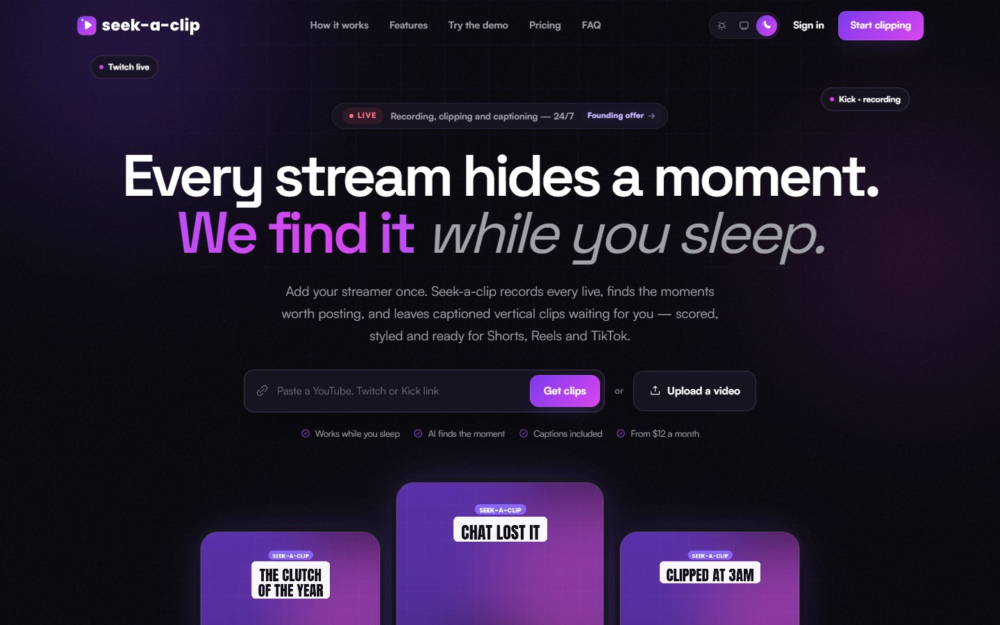
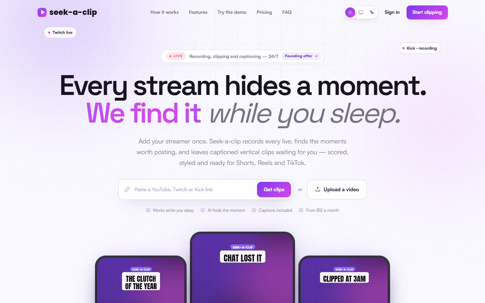
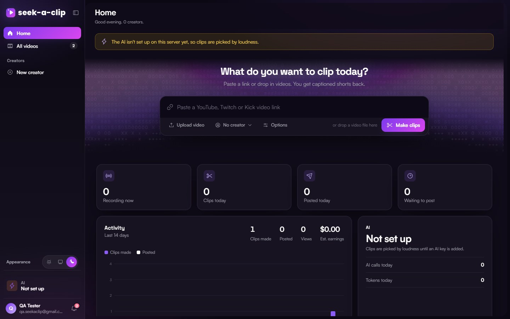

# Seek-a-clip

**Every stream hides a moment. We find it while you sleep.**

Seek-a-clip turns long streams, VODs and uploads into captioned vertical clips for
YouTube Shorts, Instagram Reels and TikTok. Add a creator once and it can record their
live streams, transcribe them, find the moments worth posting, cut them to 9:16 and
leave them ready for you.

Built on the open-source PeakCut engine (MIT), re-branded and re-designed as
Seek-a-clip.



## Screenshots

| Landing (light) | Dashboard (dark) |
|---|---|
|  |  |

## Features

**Clip making**
- Paste a YouTube, Twitch or Kick link, upload a file, or add a live creator.
- AI moment-finding with two judges: the transcript (setup, turn, payoff) and the
  reaction (loudness, chat peaks). A clip is made when both agree.
- Word-by-word captions with multiple styles, sizes and colours.
- Vertical renders in 9:16, 1:1, 16:9 and 4:5, with full-frame, blurred-fill and
  facecam layouts.
- Hooks, titles, descriptions and hashtags written from the transcript.
- Works without an AI key: clips are then chosen by loudness.

**Live**
- Record a creator automatically when they go live.
- Watch the recording while it happens.
- Clip from a live stream without waiting for the VOD.

**Workspace**
- Multi-user accounts with email and Google sign-in.
- Separate creators, clip libraries and posting queues.
- Post to YouTube Shorts, Instagram Reels and TikTok.
- AI usage, token counts and cost estimates per account.
- Admin dashboard: users, usage, storage, notices and feedback.

**Design**
- Obsidian Violet design system with light, dark and system themes.
- Responsive from 360 px phones to wide desktops.
- Reduced-motion support, keyboard focus states and visible contrast.
- Self-hosted fonts (no third-party font requests).

## Quick start

### What you need

- **Python 3.10 or newer**
- **FFmpeg** (recent build) on your `PATH`, or point `PEAKCUT_FFMPEG_DIR` at the
  folder that contains `ffmpeg`.
- About **2 GB** of free disk space for the speech model and working files.
- Optional: an AI API key (Gemini, OpenAI, xAI, Groq, OpenRouter, Anthropic, Ollama
  or any OpenAI-compatible service).

### Install

```bash
git clone https://github.com/ItsMe-Akshit/Seek-a-clip.git
cd Seek-a-clip

python -m venv .venv
# Windows
.venv\Scripts\activate
# macOS / Linux
source .venv/bin/activate

pip install -r requirements.txt
```

Copy the example settings and adjust them:

```bash
cp .env.example .env      # Windows: copy .env.example .env
```

Then start the server:

```bash
python -m studio.server
```

Open **http://127.0.0.1:8765**.

On your own computer you can leave `.env` almost empty: the dashboard opens directly
and you can add an AI key under **Settings → AI**.

## Speech model

Transcription runs locally with [sherpa-onnx](https://github.com/k2-fsa/sherpa-onnx)
and the **Parakeet TDT 0.6B v2 (int8)** model.

- **Size:** about **652 MB** unpacked.
- **Where it goes:** `<data folder>/models/sherpa-onnx-nemo-parakeet-tdt-0.6b-v2-int8/`.
  The data folder defaults to `./data`; set `PEAKCUT_DATA` to move it.
- **Automatic download:** the first time the server starts it downloads the model
  itself. This needs an internet connection once.
- **Download it ahead of time** (recommended on a server, or on a slow connection):

  ```bash
  python -m studio.fetch_model
  ```

- **Offline install:** copy the whole
  `sherpa-onnx-nemo-parakeet-tdt-0.6b-v2-int8` folder into the models folder by hand.
  Do not commit it to Git: `.gitignore` excludes `models/` and `*.onnx`.
- **Without the model** the server still starts, but it cannot transcribe, so clips
  cannot be found from speech.

The model is not included in this repository. It is downloaded from the sherpa-onnx
model collection and keeps its own licence.

## Configuration

Settings are read from environment variables, or from `.env`. See `.env.example` for
the complete annotated list.

| Variable | Default | What it does |
|---|---|---|
| `PEAKCUT_DATA` | `./data` | Videos, clips, database, fonts and the speech model |
| `PEAKCUT_PORT` | `8765` | Port the server listens on |
| `PEAKCUT_PUBLIC_URL` | `http://127.0.0.1:8765` | Address used in emails and OAuth redirects |
| `PEAKCUT_ACCOUNTS` | `0` | `1` turns on multi-user sign-in |
| `PEAKCUT_AI_PROVIDER` | `gemini` | `gemini`, `openai`, `xai`, `groq`, `openrouter`, `anthropic`, `ollama` or `custom` |
| `PEAKCUT_AI_MODELS` | provider default | One or more model ids, tried in order |
| `PEAKCUT_AI_KEY` | empty | API key (or use `PEAKCUT_AI_KEY_FILE`) |
| `GOOGLE_CLIENT_ID` / `GOOGLE_CLIENT_SECRET` | empty | Google sign-in and YouTube uploads |
| `PEAKCUT_CONTACT_EMAIL` | empty | Address shown on the legal pages |
| `PEAKCUT_UPDATE_CHECK` | `1` | `0` turns off the upstream update check (white-label installs) |
| `DATABASE_URL` | empty | Empty uses SQLite in the data folder; PostgreSQL is supported |

The environment variable prefix stays `PEAKCUT_` for compatibility with the upstream
engine. The visible product name is Seek-a-clip.

### AI providers

Pick one in **Settings → AI** (saved to `ai.json` in the data folder) or set it in
`.env`:

```dotenv
PEAKCUT_AI_PROVIDER=gemini
PEAKCUT_AI_MODELS=gemini-2.5-flash
PEAKCUT_AI_KEY=your-key
```

Without a key, Seek-a-clip still produces clips, chosen by loudness only.

### Accounts and admin

```dotenv
PEAKCUT_ACCOUNTS=1
```

Every new account is a normal user. Make yourself an admin after signing up:

```bash
python -m studio.admin grant you@example.com
# also: revoke, list
```

The admin dashboard is then at `/admin` and returns 404 for everyone else.

### Google sign-in and social posting

Create one Google OAuth **Web application** and add these authorised redirect URIs:

```text
https://YOUR-DOMAIN/auth/google/callback
https://YOUR-DOMAIN/oauth/youtube/callback
```

Instagram and TikTok app credentials can be added in **Settings → Connected apps** or
through `PEAKCUT_IG_*` / `PEAKCUT_TIKTOK_*`.

## Docker

A `Dockerfile`, `docker-compose.yml` and deployment notes are included. Copy
`.env.example` to `.env`, set `PEAKCUT_DOMAIN` and `POSTGRES_PASSWORD`, then:

```bash
docker compose up -d --build
```

See `DEPLOY.md` and the `deploy/` folder for HTTPS, Caddy, nginx, Traefik and the
optional GPU transcription worker.

## Tests

```bash
python tests/run.py
```

The suite starts a throwaway copy on a spare port with an empty data folder, so it
never touches your real clips. It covers the queue, transcription, captions, storage,
permissions, uploads, AI errors and the HTTP surface. No API keys are needed.

## Tech stack

- **Backend:** Python, FastAPI, Uvicorn, SQLAlchemy Core (SQLite or PostgreSQL)
- **Media:** FFmpeg, Pillow, yt-dlp, sherpa-onnx
- **Frontend:** hand-written HTML, CSS and JavaScript, no build step
- **Fonts:** Satoshi and Space Grotesk (self-hosted, OFL)
- **AI:** pluggable chat providers (Gemini, OpenAI, xAI, Groq, OpenRouter, Anthropic,
  Ollama, custom OpenAI-compatible)

## Project structure

```text
studio/            Python backend
  server.py        Web routes and request gate
  jobs.py          Video pipeline and fair queue
  live.py          Live recording and clipping
  transcribe.py    Speech to text
  render.py        Cutting, layouts and captions
  ai.py, brain.py  AI providers and prompts
  auth.py, account.py, admin.py, accounts.py
  db.py            Database tables
  fonts/           Bundled caption fonts (OFL)
web/               The whole front end
  landing.html     Marketing site
  index.html       Signed-in app
  auth.html, reset.html, legal.html, admin.html
  theme.css, theme.js
  brand/           Logos, favicons, demo clips
tests/             Test suite
deploy/            Docker, Caddy, nginx and GPU worker files
```

## Roadmap

- Caption style gallery with live previews and more animation presets.
- More posting integrations and a content calendar.
- Team workspaces and review links.
- Usage-based billing.
- Additional languages and RTL caption support.

## Credits and licence

Seek-a-clip is built on the MIT-licensed **PeakCut** engine. The original copyright
notice is kept in [LICENSE](LICENSE).

The product name, visual design and copy in this repository are original to
Seek-a-clip.

Bundled fonts: Satoshi and Space Grotesk (SIL Open Font License), caption fonts
Poppins, Anton and Archivo Black (SIL Open Font License; licence files are in
`studio/fonts/`).
